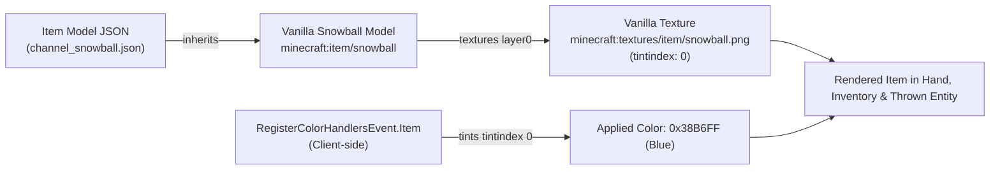

# Implementation Plan: Tinting Vanilla Snowball Model Blue

## Goal Description
The user wants to know if they can use Minecraft's built-in snowball model and apply a blue color to it for their item (`channel_snowball`), without requiring any custom texture image (`.png`) or resource pack.

**Short answer:** **Yes!** Minecraft has a built-in tinting system used by items like spawn eggs, potions, and leather armor. By referencing vanilla's model and registering an `ItemColor` handler, the game will color the vanilla snowball texture dynamically at runtime without any custom PNG image files.



---

## Technical Explanation: How Minecraft Tinting Works

1. **Model Reuse (`minecraft:item/snowball`):**
   In vanilla Minecraft, `minecraft:item/snowball.json` is defined as:
   ```json
   {
     "parent": "minecraft:item/generated",
     "textures": {
       "layer0": "minecraft:item/snowball"
     }
   }
   ```
   When a model inherits from `minecraft:item/generated`, Minecraft's `ItemModelGenerator` assigns `tintindex = 0` to all faces created from `layer0`.

2. **Color Handler (`RegisterColorHandlersEvent.Item`):**
   In NeoForge 1.21.1, client-side item colors are registered via `RegisterColorHandlersEvent.Item` on the **Mod Event Bus**.
   When rendering the item, Minecraft asks the registered color handler:
   - "What color multiplier should be applied to `layer0` (`tintIndex == 0`) for this `ItemStack`?"
   - The handler returns an RGB integer (e.g. `0x38B6FF` for a bright ice blue).

3. **Why Snowball is Ideal for Tinting:**
   The vanilla snowball texture is grayscale (white with soft gray shading). When Minecraft multiplies white/gray pixels by a color filter, it produces a clean, vibrant colored snowball without any distortion or dark discoloration.

4. **Bonus: Thrown Projectile Rendering:**
   `SnowballItem` creates a `Snowball` projectile entity and assigns the `ItemStack` to it. Vanilla's `ThrownItemRenderer` renders that entity using the item renderer—meaning **the snowball projectile flying through the air will also automatically render as blue**!

---

## User Review Required

> [!IMPORTANT]
> **Preferred Shade of Blue:**
> Which shade of blue do you prefer?
> 1. **Ice / Sky Blue (`0x38B6FF` or `0x5DADE2`)** (Recommended: looks naturally icy like a cold magic snowball).
> 2. **Deep / Royal Blue (`0x1E40AF` or `0x0055FF`)**.
> 3. **Electric / Cyan Blue (`0x00F0FF`)**.
>
> *(You can also change this color at any time in code or even make it dynamically read `DataComponents.DYED_COLOR` to allow players to dye it in a crafting table).*

---

## Proposed Changes

### 1. Item Model JSON
Create the folder structure `models/item/` inside `src/main/resources/assets/notenoughchannels/` and create the model file:

```
src/main/resources/
└── assets/
    └── notenoughchannels/
        ├── lang/
        │   └── en_us.json
        └── models/                <-- NEW FOLDER
            └── item/              <-- NEW FOLDER
                └── channel_snowball.json  <-- NEW FILE
```

#### [NEW] [channel_snowball.json](file:///A:/IDE/Intellija/not-enough-channels-1.21.1/src/main/resources/assets/notenoughchannels/models/item/channel_snowball.json)
```json
{
  "parent": "minecraft:item/snowball"
}
```

---

### 2. Client Color Registration
Register the item color handler on NeoForge's Mod event bus.

#### [MODIFY] [NotEnoughChannelsClient.kt](file:///A:/IDE/Intellija/not-enough-channels-1.21.1/src/main/kotlin/net/modelai/website/NotEnoughChannelsClient.kt)

Add the `RegisterColorHandlersEvent.Item` listener with `@EventBusSubscriber(bus = EventBusSubscriber.Bus.MOD, ...)`:

```kotlin
package net.modelai.website

import net.minecraft.client.Minecraft
import net.minecraft.world.item.ItemStack
import net.neoforged.api.distmarker.Dist
import net.neoforged.bus.api.SubscribeEvent
import net.neoforged.fml.ModContainer
import net.neoforged.fml.common.EventBusSubscriber
import net.neoforged.fml.common.Mod
import net.neoforged.fml.event.lifecycle.FMLClientSetupEvent
import net.neoforged.neoforge.client.event.RegisterColorHandlersEvent
import net.neoforged.neoforge.client.gui.ConfigurationScreen
import net.neoforged.neoforge.client.gui.IConfigScreenFactory

@Mod(value = NotEnoughChannels.MODID, dist = [Dist.CLIENT])
@EventBusSubscriber(modid = NotEnoughChannels.MODID, bus = EventBusSubscriber.Bus.MOD, value = [Dist.CLIENT])
class NotEnoughChannelsClient(container: ModContainer) {

    init {
        container.registerExtensionPoint(IConfigScreenFactory::class.java, IConfigScreenFactory { modContainer, parent ->
            ConfigurationScreen(modContainer, parent)
        })
    }

    companion object {
        @SubscribeEvent
        @JvmStatic
        fun onClientSetup(event: FMLClientSetupEvent) {
            NotEnoughChannels.LOGGER.info("HELLO FROM CLIENT SETUP")
            NotEnoughChannels.LOGGER.info("MINECRAFT NAME >> {}", Minecraft.getInstance().user.name)
        }

        @SubscribeEvent
        @JvmStatic
        fun registerItemColors(event: RegisterColorHandlersEvent.Item) {
            event.register(
                { _: ItemStack, tintIndex: Int ->
                    if (tintIndex == 0) {
                        0x38B6FF // Ice blue tint for layer0
                    } else {
                        -1 // Default / no tint for other layers
                    }
                },
                NotEnoughChannels.CHANNEL_SNOWBALL.get()
            )
        }
    }
}
```

---

## Verification Plan

### Automated Tests
1. Compile Kotlin and build resources:
   ```powershell
   ./gradlew.bat compileKotlin
   ```
2. Verify model validity and no missing assets warning during build.

### Manual Verification
1. Run the client:
   ```powershell
   ./gradlew.bat runClient
   ```
2. In-game:
   - Open Creative Inventory and navigate to the **Not Enough Channels** tab.
   - Verify `Channel Snowball` renders with the snowball shape in vibrant blue.
   - Hold it in hand (first-person and third-person view).
   - Throw the snowball: confirm the thrown projectile flying through the air is also blue.
