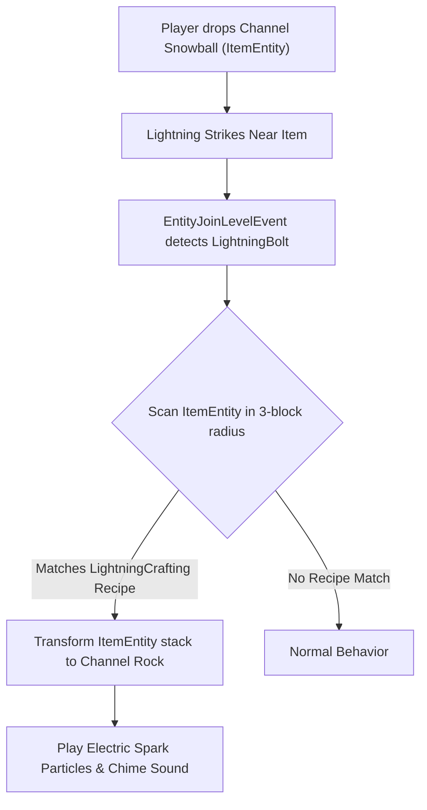

# Implementation Plan: Fix "Trying to access unbound value" Crash

## Root Cause of the Error

```
java.lang.NullPointerException: Trying to access unbound value: ResourceKey[minecraft:item / notenoughchannels:channel_snowball]
```

### Why this happens:
In [`NotEnoughChannels.kt`](file:///A:/IDE/Intellija/not-enough-channels-1.21.1/src/main/kotlin/net/modelai/website/NotEnoughChannels.kt):
```kotlin
// In init:
LightningCrafting.register(ModItems.CHANNEL_SNOWBALL.get()) { ModItems.CHANNEL_ROCK.get() }
```
`ModItems.CHANNEL_SNOWBALL` is a `DeferredItem`. During the `init` constructor of the mod, NeoForge has **not yet bound** items to the game registries.
Calling `.get()` at this stage crashes the game with `Trying to access unbound value` because the item does not exist in the registry yet.

---

## The Solution: Pass Suppliers Instead of `.get()`

By updating [`LightningCrafting.kt`](file:///A:/IDE/Intellija/not-enough-channels-1.21.1/src/main/kotlin/net/modelai/website/crafting/LightningCrafting.kt) to accept `Supplier<out Item>` directly:
```kotlin
LightningCrafting.register(ModItems.CHANNEL_SNOWBALL, ModItems.CHANNEL_ROCK)
```
- **NO `.get()` is called during startup!**
- Items are only resolved at runtime when lightning actually strikes in-game (when all registries are 100% loaded and bound).
- **Zero chance of an unbound value crash.**

---

## User Review Required

> [!IMPORTANT]
> The fix requires 3 targeted file updates:
> 1. **[`LightningCrafting.kt`](file:///A:/IDE/Intellija/not-enough-channels-1.21.1/src/main/kotlin/net/modelai/website/crafting/LightningCrafting.kt)**: Update to store `Supplier<out Item>` pairs so `.get()` is never called prematurely.
> 2. **[`NotEnoughChannels.kt`](file:///A:/IDE/Intellija/not-enough-channels-1.21.1/src/main/kotlin/net/modelai/website/NotEnoughChannels.kt)**: Call `LightningCrafting.register(ModItems.CHANNEL_SNOWBALL, ModItems.CHANNEL_ROCK)` (no `.get()`), and ensure both `this` and `LightningCraftingHandler` are registered on `NeoForge.EVENT_BUS`.
> 3. **[`ChannelStickItem.kt`](file:///A:/IDE/Intellija/not-enough-channels-1.21.1/src/main/kotlin/net/modelai/website/item/custom/ChannelStickItem.kt)**: Remove redundant duplicate `level.addFreshEntity(lightning)` on line 59.

---

## Exact Code Changes

### 1. `src/main/kotlin/net/modelai/website/crafting/LightningCrafting.kt`
Replace the entire content with this crash-proof supplier implementation:

```kotlin
package net.modelai.website.crafting

import net.minecraft.world.item.Item
import java.util.function.Supplier

object LightningCrafting {

    private val RECIPES = mutableListOf<Pair<Supplier<out Item>, Supplier<out Item>>>()

    fun register(input: Supplier<out Item>, output: Supplier<out Item>) {
        RECIPES.add(input to output)
    }

    fun getResult(input: Item): Item? {
        return RECIPES.firstOrNull { it.first.get() == input }?.second?.get()
    }

    fun hasRecipe(input: Item): Boolean {
        return RECIPES.any { it.first.get() == input }
    }
}
```

---

### 2. `src/main/kotlin/net/modelai/website/NotEnoughChannels.kt`
Update the `init` block:

```kotlin
    init {
        // Register the commonSetup method for modloading
        modEventBus.addListener(::commonSetup)

        // Register items and creative tabs to the mod event bus
        ModItems.register(modEventBus)
        ModCreativeTabs.register(modEventBus)

        // Register ourselves and crafting handler for server events
        NeoForge.EVENT_BUS.register(this)
        NeoForge.EVENT_BUS.register(LightningCraftingHandler)

        // Register config
        modContainer.registerConfig(ModConfig.Type.COMMON, Config.SPEC)

        // Register Crafting recipe (NO .get() — passed as Suppliers!)
        LightningCrafting.register(ModItems.CHANNEL_SNOWBALL, ModItems.CHANNEL_ROCK)
    }
```

---

### 3. `src/main/kotlin/net/modelai/website/item/custom/ChannelStickItem.kt`
Remove duplicate line 59:

```diff
--- a/src/main/kotlin/net/modelai/website/item/custom/ChannelStickItem.kt
+++ b/src/main/kotlin/net/modelai/website/item/custom/ChannelStickItem.kt
@@ -56,6 +56,5 @@
         for (target in targets) {
             target.hurt(level.damageSources().lightningBolt(), 5.0f) // 5.0 = 2.5 hearts
         }
-        level.addFreshEntity(lightning)
     }
```

---

## Verification Plan

### Automated Build Verification
1. Run `./gradlew.bat compileKotlin` to verify no compilation errors.
2. Run `./gradlew.bat runClient` to verify the game loads into the main menu without any `unbound value` crashes.

### In-Game Verification
1. Enter a world.
2. Drop a `Channel Snowball` on the ground.
3. Right-click with `Channel Stick` at/near the snowball.
4. Verify the snowball transforms into `Channel Rock` with sparks and chime sound!


---

## User Review Required

> [!IMPORTANT]
> To make it work, 3 quick changes are needed:
> 1. Add the 2 registration lines and imports to [`NotEnoughChannels.kt`](file:///A:/IDE/Intellija/not-enough-channels-1.21.1/src/main/kotlin/net/modelai/website/NotEnoughChannels.kt).
> 2. Add the `register(Item, Item)` overload to [`LightningCrafting.kt`](file:///A:/IDE/Intellija/not-enough-channels-1.21.1/src/main/kotlin/net/modelai/website/crafting/LightningCrafting.kt).
> 3. Remove the duplicate `addFreshEntity` call on line 59 in [`ChannelStickItem.kt`](file:///A:/IDE/Intellija/not-enough-channels-1.21.1/src/main/kotlin/net/modelai/website/item/custom/ChannelStickItem.kt).

---

## Proposed Changes

### Component: `net.modelai.website.crafting`

#### [MODIFY] [`LightningCrafting.kt`](file:///A:/IDE/Intellija/not-enough-channels-1.21.1/src/main/kotlin/net/modelai/website/crafting/LightningCrafting.kt)
Add overload so you can pass items directly:
```kotlin
    fun register(input: Item, output: Item) {
        RECIPES[input] = { output }
    }
```

---

### Component: Main Mod Entrypoint

#### [MODIFY] [`NotEnoughChannels.kt`](file:///A:/IDE/Intellija/not-enough-channels-1.21.1/src/main/kotlin/net/modelai/website/NotEnoughChannels.kt)

##### Imports to add:
```kotlin
import net.modelai.website.crafting.LightningCrafting
import net.modelai.website.crafting.LightningCraftingHandler
```

##### Inside `init`:
```kotlin
        // Register lightning crafting event handler
        NeoForge.EVENT_BUS.register(LightningCraftingHandler)
```

##### Inside `commonSetup`:
```kotlin
        // Register lightning crafting recipe: Snowball -> Rock
        LightningCrafting.register(ModItems.CHANNEL_SNOWBALL.get(), ModItems.CHANNEL_ROCK.get())
```

---

### Component: Channel Stick

#### [MODIFY] [`ChannelStickItem.kt`](file:///A:/IDE/Intellija/not-enough-channels-1.21.1/src/main/kotlin/net/modelai/website/item/custom/ChannelStickItem.kt)
Remove the second `level.addFreshEntity(lightning)` call on line 59.

---

## Full Git Diffs to Apply

### 1. `NotEnoughChannels.kt`
```diff
--- a/src/main/kotlin/net/modelai/website/NotEnoughChannels.kt
+++ b/src/main/kotlin/net/modelai/website/NotEnoughChannels.kt
@@ -4,6 +4,8 @@
 import net.minecraft.core.registries.BuiltInRegistries
 import net.minecraft.world.level.block.Blocks
+import net.modelai.website.crafting.LightningCrafting
+import net.modelai.website.crafting.LightningCraftingHandler
 import net.modelai.website.item.ModItems
 import net.modelai.website.tab.ModCreativeTabs
 import net.neoforged.bus.api.IEventBus
@@ -34,6 +36,7 @@
 
         // Register ourselves for server events
         NeoForge.EVENT_BUS.register(this)
+        NeoForge.EVENT_BUS.register(LightningCraftingHandler)
 
         // Register config
         modContainer.registerConfig(ModConfig.Type.COMMON, Config.SPEC)
@@ -41,6 +44,8 @@
     private fun commonSetup(event: FMLCommonSetupEvent) {
         LOGGER.info("HELLO FROM COMMON SETUP")
 
+        LightningCrafting.register(ModItems.CHANNEL_SNOWBALL.get(), ModItems.CHANNEL_ROCK.get())
+
         if (Config.LOG_DIRT_BLOCK.getAsBoolean()) {
             LOGGER.info("DIRT BLOCK >> {}", BuiltInRegistries.BLOCK.getKey(Blocks.DIRT))
         }
```

### 2. `LightningCrafting.kt`
```diff
--- a/src/main/kotlin/net/modelai/website/crafting/LightningCrafting.kt
+++ b/src/main/kotlin/net/modelai/website/crafting/LightningCrafting.kt
@@ -10,6 +10,10 @@
 
     private val RECIPES = mutableMapOf<Item, () -> Item>()
 
+    fun register(input: Item, output: Item) {
+        RECIPES[input] = { output }
+    }
+
     fun register(input: Item, outputSupplier: () -> Item) {
         RECIPES[input] = outputSupplier
     }
```

### 3. `ChannelStickItem.kt`
```diff
--- a/src/main/kotlin/net/modelai/website/item/custom/ChannelStickItem.kt
+++ b/src/main/kotlin/net/modelai/website/item/custom/ChannelStickItem.kt
@@ -56,6 +56,5 @@
         for (target in targets) {
             target.hurt(level.damageSources().lightningBolt(), 5.0f) // 5.0 = 2.5 hearts
         }
-        level.addFreshEntity(lightning)
     }
```

---

## Proposed Architecture & Workflow



### Key Technical Details

1. **Why `EntityJoinLevelEvent`?**
   - In Minecraft / NeoForge, if a lightning bolt is set to `visualOnly = true` (which was configured on the Channel Stick to prevent fire), vanilla Minecraft's `LightningBolt.tick()` **skips** entity collisions and does NOT fire `EntityStruckByLightningEvent`.
   - By listening to `EntityJoinLevelEvent` on `NeoForge.EVENT_BUS`, our crafting system intercepts **every** lightning strike (from `ChannelStickItem`, natural thunderstorms, Tridents with Channeling, or commands) immediately on the server tick it spawns.
   - It also transforms the item *instantly*, preventing natural lightning fire from destroying the item entity.

2. **Item Protection (`EntityStruckByLightningEvent`)**:
   - For natural lightning bolts where `visualOnly == false`, vanilla strikes deal 5.0 damage to entities and ignite them, which would normally vaporize non-fireproof dropped items like snowballs.
   - We will listen to `EntityStruckByLightningEvent` and cancel it for recipe input/output items so they never get burned up before or after crafting.

3. **In-Place Stack Conversion**:
   - Calling `itemEntity.item = ItemStack(outputItem, currentStack.count)` preserves the entity's position, momentum, and age while immediately synchronizing the visual model to all connected clients.

---

## Proposed Changes

### Component: `net.modelai.website.crafting`

#### [NEW] `src/main/kotlin/net/modelai/website/crafting/LightningCrafting.kt`
- Manages registration and lookup of lightning transformation recipes.
- Provides a clean API: `LightningCrafting.register(ModItems.CHANNEL_SNOWBALL.get(), ModItems.CHANNEL_ROCK.get())`.

```kotlin
package net.modelai.website.crafting

import net.minecraft.world.item.Item
import net.minecraft.world.item.ItemStack
import java.util.function.Supplier

object LightningCrafting {
    // Maps Input Item -> Output Item Supplier/Item
    private val RECIPES = mutableMapOf<Item, () -> Item>()

    fun register(input: Item, outputSupplier: () -> Item) {
        RECIPES[input] = outputSupplier
    }

    fun getResult(input: Item): Item? {
        return RECIPES[input]?.invoke()
    }

    fun hasRecipe(input: Item): Boolean {
        return RECIPES.containsKey(input)
    }
}
```

---

#### [NEW] `src/main/kotlin/net/modelai/website/crafting/LightningCraftingHandler.kt`
- Subscribed to `NeoForge.EVENT_BUS`.
- Handles `EntityJoinLevelEvent`:
  - When `event.entity is LightningBolt` on the server:
  - Queries `ItemEntity` within an `AABB.ofSize(lightning.position(), 6.0, 6.0, 6.0)` (3-block radius).
  - Checks if `LightningCrafting.hasRecipe(itemEntity.item.item)`.
  - Replaces `itemEntity.item` with the transformed item stack.
  - Spawns `ParticleTypes.ELECTRIC_SPARK` and plays `SoundEvents.AMETHYST_BLOCK_CHIME` (or `SoundEvents.LIGHTNING_BOLT_IMPACT`).
- Handles `EntityStruckByLightningEvent`:
  - If `event.entity is ItemEntity` and its item is part of the crafting system, cancels the event (`event.isCanceled = true`) so natural lightning doesn't incinerate it.

```kotlin
package net.modelai.website.crafting

import net.minecraft.core.particles.ParticleTypes
import net.minecraft.server.level.ServerLevel
import net.minecraft.sounds.SoundEvents
import net.minecraft.sounds.SoundSource
import net.minecraft.world.entity.LightningBolt
import net.minecraft.world.entity.item.ItemEntity
import net.minecraft.world.item.ItemStack
import net.minecraft.world.phys.AABB
import net.neoforged.bus.api.SubscribeEvent
import net.neoforged.neoforge.event.entity.EntityJoinLevelEvent
import net.neoforged.neoforge.event.entity.EntityStruckByLightningEvent

object LightningCraftingHandler {

    @SubscribeEvent
    fun onEntityJoinLevel(event: EntityJoinLevelEvent) {
        val level = event.level as? ServerLevel ?: return
        val lightning = event.entity as? LightningBolt ?: return

        // 3-block horizontal and vertical radius around strike
        val area = AABB.ofSize(lightning.position(), 6.0, 6.0, 6.0)
        val items = level.getEntitiesOfClass(ItemEntity::class.java, area)

        for (itemEntity in items) {
            val currentStack = itemEntity.item
            val resultItem = LightningCrafting.getResult(currentStack.item) ?: continue

            // Transform item in-place preserving stack count
            itemEntity.item = ItemStack(resultItem, currentStack.count)

            // Visual and audio effects
            level.sendParticles(
                ParticleTypes.ELECTRIC_SPARK,
                itemEntity.x, itemEntity.y + 0.2, itemEntity.z,
                25, 0.25, 0.25, 0.25, 0.1
            )
            level.playSound(
                null,
                itemEntity.blockPosition(),
                SoundEvents.AMETHYST_BLOCK_CHIME,
                SoundSource.BLOCKS,
                1.5f,
                1.0f
            )
        }
    }

    @SubscribeEvent
    fun onEntityStruckByLightning(event: EntityStruckByLightningEvent) {
        val itemEntity = event.entity as? ItemEntity ?: return
        if (LightningCrafting.hasRecipe(itemEntity.item.item)) {
            event.isCanceled = true // Prevent burning/destruction from natural lightning
        }
    }
}
```

---

### Component: Mod Lifecycle Integration

#### [MODIFY] `src/main/kotlin/net/modelai/website/NotEnoughChannels.kt`

##### 1. New Imports to Add (around Line 6-8):
```kotlin
import net.modelai.website.crafting.LightningCrafting
import net.modelai.website.crafting.LightningCraftingHandler
```

##### 2. Event Bus Registration in `init` block (Line 36):
Right under `NeoForge.EVENT_BUS.register(this)` on Line 35:
```kotlin
        // Register ourselves for server events
        NeoForge.EVENT_BUS.register(this)
        NeoForge.EVENT_BUS.register(LightningCraftingHandler) // <-- ADD THIS LINE (Line 36)
```

##### 3. Recipe Registration in `commonSetup` (Line 43):
Inside `private fun commonSetup(event: FMLCommonSetupEvent)`:
> [!IMPORTANT]
> `ModItems.CHANNEL_SNOWBALL.get()` should be called in `commonSetup` (not `init`) because items must be registered by NeoForge registries before `.get()` is called. Calling `.get()` inside `init` would throw an `IllegalStateException: Registry Object not present`.

```kotlin
    private fun commonSetup(event: FMLCommonSetupEvent) {
        LOGGER.info("HELLO FROM COMMON SETUP")

        // Register lightning crafting recipes (A + Lightning = B)
        LightningCrafting.register(ModItems.CHANNEL_SNOWBALL.get(), ModItems.CHANNEL_ROCK.get()) // <-- ADD THIS LINE
```

##### Full before vs after diff in `NotEnoughChannels.kt`:
```diff
--- a/src/main/kotlin/net/modelai/website/NotEnoughChannels.kt
+++ b/src/main/kotlin/net/modelai/website/NotEnoughChannels.kt
@@ -4,6 +4,8 @@
 import net.minecraft.core.registries.BuiltInRegistries
 import net.minecraft.world.level.block.Blocks
+import net.modelai.website.crafting.LightningCrafting
+import net.modelai.website.crafting.LightningCraftingHandler
 import net.modelai.website.item.ModItems
 import net.modelai.website.tab.ModCreativeTabs
 import net.neoforged.bus.api.IEventBus
@@ -34,6 +36,7 @@
 
         // Register ourselves for server events
         NeoForge.EVENT_BUS.register(this)
+        NeoForge.EVENT_BUS.register(LightningCraftingHandler)
 
         // Register config
         modContainer.registerConfig(ModConfig.Type.COMMON, Config.SPEC)
@@ -41,6 +44,8 @@
     private fun commonSetup(event: FMLCommonSetupEvent) {
         LOGGER.info("HELLO FROM COMMON SETUP")
 
+        LightningCrafting.register(ModItems.CHANNEL_SNOWBALL.get(), ModItems.CHANNEL_ROCK.get())
+
         if (Config.LOG_DIRT_BLOCK.getAsBoolean()) {
             LOGGER.info("DIRT BLOCK >> {}", BuiltInRegistries.BLOCK.getKey(Blocks.DIRT))
         }
```

---

## Open Questions

> [!NOTE]
> 1. **Conversion Ratio**: When a stack of 16 snowballs is hit by lightning, should the whole stack of 16 convert to 16 rocks (1:1), or only 1 item per strike? *(Recommended: 1:1 whole stack conversion).*
> 2. **Strike Radius**: A 3-block radius (6x6x6 box) is proposed. Would you like this radius smaller (e.g. direct hit only, 1.5 blocks) or larger?
> 3. **Thrown Snowballs vs Dropped Items**: Does "channel snowball" mean the dropped item on the ground (via `Q` or inventory drop), or also thrown snowballs in mid-air? *(Recommended: Dropped items on the ground, which is standard for in-world modded crafting).*

---

## Verification Plan

### Automated Build Verification
1. Run compilation to ensure types and imports resolve:
   ```powershell
   .\gradlew.bat compileKotlin
   ```

### Manual In-Game Testing
1. Launch client via `.\gradlew.bat runClient`.
2. Drop a `Channel Snowball` on the ground.
3. Right-click nearby or at the snowball using the `Channel Stick` (summoning a thunderbolt).
4. Verify:
   - The snowball transforms into a `Channel Rock`.
   - Electric spark particles and chime sound play.
   - Stack size is preserved (e.g., 5 snowballs become 5 rocks).
   - No unwanted fire blocks remain on the ground.
