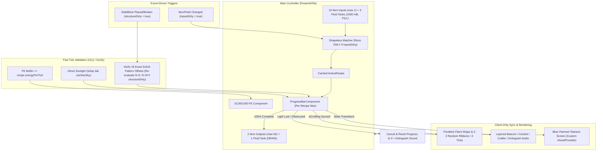

# Plan: Floating Multiblock Solar Machine (Titanium + Lodestone)

## 📌 Context & Overview

This plan outlines the architecture, performance optimizations, and phased implementation steps for an advanced multiblock solar machine for **Minecraft 1.21.1 NeoForge** (`21.1.265`) in Kotlin.

### Core Specifications
1. **Main Controller Block (`B`)**: A floating central block at relative coordinate $(0, 0, 0)$ (center of Layer 3) containing the machine logic, inventory, fluid tanks, energy storage, and GUI.
2. **16 Side Structure Blocks (`A`)**: Placed at 16 exact relative offsets across Layers 1–4 of a $5 \times 5 \times 5$ structure around the main controller block.
3. **Exact 5x5x5 Multiblock Pattern (with $0^\circ$ / $90^\circ$ Rotational Symmetry)**:
   - Non-structure positions (`x`) are unconstrained (can be air, cables, pipes, etc.), while the 16 `A` positions must strictly contain `SideStructureBlock`.
   - Because every layer has $180^\circ$ point-reflection symmetry, checking North-South ($0^\circ$) and East-West ($90^\circ$) orientations covers all 4 cardinal directions:
     ```text
     Layer 1 (Y = -2)    Layer 2 (Y = -1)    Layer 3 (Y = 0)     Layer 4 (Y = +1)    Layer 5 (Y = +2)
     x x x x x           x x A x x           A x x x A           x x A x x           x x x x x
     A x x x A           x x x x x           x x x x x           x x x x x           x x x x x
     x A x A x           x x x x x           x x B x x           A x x x A           x x x x x
     A x x x A           x x x x x           x x x x x           x x x x x           x x x x x
     x x x x x           x x A x x           A x x x A           x x A x x           x x x x x
     (6 blocks)          (2 blocks)          (4 blocks + B)      (4 blocks)          (Empty / Sky)
     ```
4. **Daylight, Clear Weather & Sunlight Requirement**: Requires direct sky access (`level.canSeeSky(worldPosition.above())`), daytime (`level.isDay()`), and clear weather (`!level.isRaining()`). If sunlight is obstructed, rain/thunder starts, or night falls mid-craft, crafting is immediately **canceled and progress resets to 0** (without consuming the input items/fluids).
5. **Energy**: Standard NeoForge Energy (FE) with a **10,000,000 FE** buffer (`PoweredTile`).
6. **Blue Titanium GUI**:
   - **10 Item Input Slots**: Maximum stack limit of **1** per slot (`.setSlotLimit(1)`).
   - **3 Fluid Input Tanks**: Maximum capacity of **1,000 mB** (1 bucket) per tank (`Action.FILL`).
   - **2 Item Output Slots**: Standard stack sizes up to **64** (`.setSlotLimit(64)`).
   - **1 Fluid Output Tank**: Maximum capacity of **1,000 mB** (1 bucket, `Action.DRAIN`).
   - **Energy Gauge**: Visual bar for 10,000,000 FE.
   - **Progress Bar**: Animated cyan/blue crafting progress indicator.
   - **Custom Blue Theme**: Deep navy background (`#0A192F`) with bright cyan accents (`#00D2FF`).
7. **Crafting Mechanics**:
   - **Shapeless**: Ingredients can be placed in any of the 10 item input slots or 3 fluid input tanks.
   - **Automatic Start**: Starts automatically as soon as valid ingredients, output space, FE, clear daylight, and 16+ side blocks are present.
   - **Safe Consumption at 100% Completion**: Inputs remain in the slots/tanks during crafting and are consumed **only when progress reaches 100%**. If a player/pipe removes a required input mid-craft, or if sunlight is lost, progress resets to `0`.
   - **Per-Recipe Duration & FE Cost**: Each recipe defines its own `durationTicks` and `energyPerTick`.
8. **Visuals & Audio**:
   - **VFX / Non-Vanilla Particles**: Powered by **Lodestone** (glowing wisps and converging energy ribbons without custom particle textures).
   - **Sounds**: Built-in **Minecraft Sound Events** (layered beacon, conduit, crafter, vault, and extinguish cues).

---

## 🔍 Technical Audit & Performance Improvements

During plan review, the following performance bottlenecks and NeoForge 1.21.1 / Titanium 4.0.43 API issues were identified and resolved in this updated plan:

### ⚡ 1. Performance Optimizations
| Issue in Initial Draft | Impact | Optimized Solution in Updated Plan |
| :--- | :--- | :--- |
| **Full volume scan every 20 ticks** | High MSPT cost when multiple machines exist even when idle. | **Event-Driven Dirty Flag + $O(16)$ Exact 5x5x5 Offset Verification**: `SideStructureBlock` notifies nearby controllers within $5 \times 5 \times 5$ bounds on `onPlace`/`onRemove` (`structureDirty = true`). When not dirty, the controller only checks its 16 cached `BlockPos` locations ($O(16)$ fast path), and when dirty, evaluates only the 16 exact relative offsets of `PATTERN_OFFSETS_NS` ($0^\circ$) and `PATTERN_OFFSETS_EW` ($90^\circ$). |
| **Shapeless recipe matching every tick (20/sec)** | Permuting 10 item slots + 3 fluid tanks against all recipes every tick wastes CPU while idle or mid-craft. | **Dirty-Flag Inventory/Tank Listeners + Active Recipe Cache**: Hook `InventoryComponent.setOnSlotChanged` and `FluidTankComponent.setOnContentChange` to set `inputsDirty = true`. Search recipes *only* when `inputsDirty` is true. Cache `activeRecipe` during crafting so ticks only check sunlight and drain FE. |
| **Server-dispatched Lodestone particles for 16 blocks** | Sending 16+ particle packets per tick per machine floods client-server network bandwidth. | **Client-Side `clientTick` Spawning + Throttled Ribbon Sampling**: Sync only `isCrafting: Boolean` and `cachedSidePositions` via BlockEntity update tag. Spawn central wisps every 2 ticks on the client, and pick 2–3 random cached side blocks every 4 ticks to emit converging ribbons. |

### 🛠️ 2. NeoForge 1.21.1 & Titanium 4.0.43 API Fixes
1. **ModDevGradle Dependency Syntax (`fg.deobf` Removal)**:
   - NeoForge 1.21.1 uses `net.neoforged.moddev` (`2.0.148`) with Official Mojang Mappings at runtime. `fg.deobf(...)` is legacy ForgeGradle syntax and fails with `Could not get unknown property 'fg'`. Use `implementation 'curse.maven:lodestone-616457:7264731'` directly.
2. **Use Titanium's `PoweredTile<T>` Instead of Raw `ActiveTile<T>`**:
   - Titanium 4.0.43 provides `com.hrznstudio.titanium.block.tile.PoweredTile<T>` (which extends `ActiveTile<T>`) and automatically serializes, syncs, and attaches the `EnergyStorageComponent<T>` via `override fun createEnergyStorage()`.
3. **Exact `FluidTankComponent` Constructor & Action Filtering**:
   - Titanium's `FluidTankComponent` does not have `.setCapacity()`. Capacity is passed directly in the constructor: `FluidTankComponent(name, capacity, posX, posY)`.
   - Input tanks must use `.setTankAction(FluidTankComponent.Action.FILL)` and the output tank must use `.setTankAction(FluidTankComponent.Action.DRAIN)` so external pipes (Pipez, AE2) cannot pump input fluids out or fill the output tank.
4. **Side Block Skylight Propagation (`noOcclusion`)**:
   - Because side blocks can float *above* the main block, a solid `SideStructureBlock` placed directly above the controller would block sky access and cause `canSeeSky(worldPosition.above())` to return `false`. `SideStructureBlock` must configure `.noOcclusion()` and `isViewBlocking { _, _, _ -> false }` / `propagatesSkylightDown` so floating structure blocks above the controller never obstruct sunlight.
5. **Lazy `Supplier` Recipe Registration (`AGENT.md` Rule #6)**:
   - Never call `.get()` on `DeferredItem` or `DeferredHolder` during `NotEnoughChannels.init`. `SolarMachineCrafting` must store `Supplier<out Item>` and `Supplier<out Fluid>` and resolve them lazily at runtime.
6. **External Pipe & Cable Compatibility (`RegisterCapabilitiesEvent`)**:
   - Explicitly verify/register NeoForge block capabilities (`Capabilities.EnergyStorage.BLOCK`, `Capabilities.FluidHandler.BLOCK`, `Capabilities.ItemHandler.BLOCK`) on `modEventBus` so `Pipez`, `AE2`, and `Just Dire Things` interact seamlessly with inputs and outputs.

---

## 🏗️ Architecture & Component Flow



---

## 🚀 Phased Implementation Plan (For Agent Execution)

Each phase is scoped to be independently verifiable via `./gradlew.bat compileKotlin` before moving to the next phase.

---

### Phase 1: Build Configuration & Library Dependencies
**Goal**: Configure Gradle repositories and compile-time dependencies for Titanium and Lodestone on NeoForge 1.21.1 without breaking existing `localRuntime` test mods.

#### Files to Modify
- `build.gradle`
- `src/main/templates/META-INF/neoforge.mods.toml`

#### Tasks
1. **Add CurseMaven Repository** in `build.gradle`:
   ```groovy
   repositories {
       maven {
           name = 'Kotlin for Forge'
           url = 'https://thedarkcolour.github.io/KotlinForForge/'
       }
       maven {
           name = 'CurseMaven'
           url = 'https://cursemaven.com'
           content {
               includeGroup 'curse.maven'
           }
       }
       maven {
           name = 'BlameJared'
           url = 'https://maven.blamejared.com/'
       }
   }
   ```
2. **Configure Dependencies** in `build.gradle` (no `fg.deobf` on ModDevGradle 2.0.148):
   ```groovy
   dependencies {
       implementation 'thedarkcolour:kotlinforforge-neoforge:5.12.0'

       // Compile & runtime libraries for the multiblock solar machine
       implementation files('libs/titanium-1.21-4.0.43.jar')
       implementation 'curse.maven:lodestone-616457:7264731'

       // Load remaining test mods locally (excluding titanium to avoid duplicate classpath entries)
       localRuntime fileTree(dir: 'libs', include: ['*.jar'], exclude: ['titanium-*.jar'])
   }
   ```
3. **Declare Dependencies** in `src/main/templates/META-INF/neoforge.mods.toml` for `titanium` and `lodestone`.

#### Phase 1 Verification Gate
- Run `./gradlew.bat compileKotlin` and confirm dependencies resolve and compile with 0 errors.

---

### Phase 2: Blocks, BlockEntity & Capability Registration
**Goal**: Register the floating `Main Controller Block`, the skylight-transparent `Side Structure Block`, their `BlockItem`s, creative tab entries, and `BlockEntityType`.

#### Files to Create / Modify
- `src/main/kotlin/net/modelai/website/block/ModBlocks.kt` (New)
- `src/main/kotlin/net/modelai/website/block/custom/SolarMultiblockMachineBlock.kt` (New)
- `src/main/kotlin/net/modelai/website/block/custom/SideStructureBlock.kt` (New)
- `src/main/kotlin/net/modelai/website/block/entity/ModBlockEntities.kt` (New)
- `src/main/kotlin/net/modelai/website/item/ModItems.kt` (Modify: register BlockItems)
- `src/main/kotlin/net/modelai/website/tab/ModCreativeTabs.kt` (Modify: add blocks to tab)
- `src/main/kotlin/net/modelai/website/NotEnoughChannels.kt` (Modify: attach `ModBlocks` and `ModBlockEntities` to `modEventBus`)
- `src/main/resources/assets/notenoughchannels/lang/en_us.json` (Modify: add block translations)

#### Tasks
1. **`SideStructureBlock`**:
   - Extend `Block` with `.noOcclusion()` so floating side blocks placed above the main block never block skylight (`canSeeSky`).
   - Override `onPlace` and `onRemove` to scan the $5 \times 5 \times 5$ controller offset bounds (`pos.offset(-2, -1, -2)` to `pos.offset(2, 2, 2)`) for any `SolarMultiblockTileEntity` and call `tile.markStructureDirty()`.
2. **`SolarMultiblockMachineBlock`**:
   - Extend Titanium's `BasicTileBlock<SolarMultiblockTileEntity>` with `.noOcclusion()`.
   - Implement `getTileEntityFactory()` returning `BlockEntitySupplier { pos, state -> SolarMultiblockTileEntity(pos, state) }`.
3. **Capabilities Wiring**:
   - Register `RegisterCapabilitiesEvent` listener on `modEventBus` exposing `EnergyStorage.BLOCK`, `FluidHandler.BLOCK`, and `ItemHandler.BLOCK` from `SolarMultiblockTileEntity`.

#### Phase 2 Verification Gate
- Run `./gradlew.bat compileKotlin` to verify block, item, and capability registrations compile cleanly.

---

### Phase 3: Lazy Shapeless Recipe System (`SolarMachineCrafting`)
**Goal**: Build a thread-safe, lazily evaluated recipe registry supporting up to 10 item inputs (count 1 each), 3 fluid inputs ($\le 1,000\text{ mB}$ each), 2 item outputs (count up to 64), 1 fluid output, duration in ticks, and FE/tick.

#### Files to Create / Modify
- `src/main/kotlin/net/modelai/website/crafting/SolarMachineCrafting.kt` (New)
- `src/main/kotlin/net/modelai/website/NotEnoughChannels.kt` (Modify: register sample solar machine recipes)

#### Tasks
1. **Lazy Ingredient & Output Wrappers** (preventing early `.get()` crashes during `init`):
   - `SolarItemIngredient(val item: Supplier<out Item>)` (always 1 per slot, can repeat across multiple slots if a recipe needs multiple of the same item).
   - `SolarFluidIngredient(val fluid: Supplier<out Fluid>, val amountMb: Int)` (where `amountMb in 1..1000`).
   - `SolarItemOutput(val item: Supplier<out Item>, val count: Int)` (where `count in 1..64`).
   - `SolarFluidOutput(val fluid: Supplier<out Fluid>, val amountMb: Int)`.
2. **Shapeless Matcher Algorithm**:
   - Given the 10 input slots and 3 input fluid tanks, verify that a 1-to-1 slot/tank assignment exists for all required item and fluid ingredients of a `SolarRecipe`.
   - Verify that output slots (2) and the output fluid tank (1) have capacity to accept the recipe's outputs (`canAcceptOutputs`).
3. **Kotlin DSL Helper**:
   ```kotlin
   SolarMachineCrafting.register(
       itemInputs = listOf(solarItem(Items.DIAMOND), solarItem(ModItems.CHANNEL_APPLE)),
       fluidInputs = listOf(solarFluid(Fluids.WATER, 1000)),
       itemOutputs = listOf(solarOutput(Items.NETHERITE_INGOT, 16)),
       fluidOutput = solarFluidOutput(Fluids.LAVA, 1000),
       durationTicks = 200,
       energyPerTick = 1000
   )
   ```

#### Phase 3 Verification Gate
- Run `./gradlew.bat compileKotlin` and verify recipe DSL registration in `NotEnoughChannels.kt`.

---

### Phase 4: Core Machine Tile Entity (`SolarMultiblockTileEntity`)
**Goal**: Implement the `PoweredTile` controller with 10M FE storage, 10 input slots, 3 fluid input tanks, 2 output slots, 1 fluid output tank, cached $O(16)$ structure validation, and daylight/sky-access enforcement.

#### Files to Create
- `src/main/kotlin/net/modelai/website/block/entity/SolarMultiblockTileEntity.kt` (New)

#### Tasks
1. **Extend `PoweredTile<SolarMultiblockTileEntity>`**:
   - Override `createEnergyStorage()`:
     ```kotlin
     override fun createEnergyStorage(): EnergyStorageComponent<SolarMultiblockTileEntity> {
         return EnergyStorageComponent(10_000_000, 100_000, 100_000, 10, 20)
     }
     ```
2. **Configure Inventories (`InventoryComponent`)**:
   - `inputInventory`: 10 slots (`setRange(5, 2)`), `.setSlotLimit(1)`, `.setOutputFilter { _, _ -> false }` (pipes cannot extract inputs), `.setOnSlotChanged { _, _ -> inputsDirty = true }`.
   - `outputInventory`: 2 slots (`setRange(1, 2)`), `.setSlotLimit(64)`, `.setInputFilter { _, _ -> false }` (pipes/players cannot insert into outputs), `.setOnSlotChanged { _, _ -> inputsDirty = true }`.
3. **Configure Fluid Tanks (`FluidTankComponent`)**:
   - `inputTank1`, `inputTank2`, `inputTank3`: capacity `1000` mB each, `.setTankAction(FluidTankComponent.Action.FILL)`, `.setOnContentChange { inputsDirty = true }`.
   - `outputTank`: capacity `1000` mB (1 bucket, matching input tanks), `.setTankAction(FluidTankComponent.Action.DRAIN)`, `.setOnContentChange { inputsDirty = true }`.
4. **Exact 5x5x5 Multiblock Pattern Validator**:
   - Define `PATTERN_OFFSETS_NS` (16 exact relative offsets for Layers 1–4) and `PATTERN_OFFSETS_EW` (rotated $90^\circ$: `BlockPos(-pos.z, pos.y, pos.x)`).
   - Maintain `cachedSidePositions: MutableList<BlockPos>` and `structureDirty: Boolean = true`.
   - Every 20 ticks:
     - If `!structureDirty && isStructureValid && cachedSidePositions.size == 16`, verify those 16 `BlockPos` still hold `ModBlocks.SIDE_STRUCTURE_BLOCK.get()` ($O(16)$ fast path). If any changed, set `structureDirty = true`.
     - If `structureDirty`, evaluate `PATTERN_OFFSETS_NS` and `PATTERN_OFFSETS_EW` relative to `worldPosition`, pick the orientation with the highest match count, set `isStructureValid = (matchedPositions.size == 16)`, update `cachedSidePositions`, set `structureDirty = false`, and sync to client if changed.
5. **Sunlight & Clear Weather Check + Immediate Reset**:
   - `fun hasSunlight(): Boolean = level?.let { it.isDay && !it.isRaining && it.canSeeSky(worldPosition.above()) } == true`
   - In `serverTick`:
     - If `progressBar.progress > 0 && !hasSunlight()`:
       - Set `progressBar.progress = 0`
       - Play `SoundEvents.FIRE_EXTINGUISH` (pitch 0.8f) + `SoundEvents.CONDUIT_DEACTIVATE`
       - Sync `isCrafting = false` to client and mark dirty.
6. **Crafting Loop (Safe 100% Completion Consumption)**:
   - When `inputsDirty` is true:
     - Re-match `activeRecipe` via `SolarMachineCrafting.findMatchingRecipe(...)` and clear `inputsDirty = false`.
     - If a craft was in progress and the player/pipe removed a required ingredient so `activeRecipe` changed or became `null`, immediately reset `progressBar.progress = 0`.
   - When `activeRecipe != null`, `isStructureValid`, `hasSunlight()`, and `energyStorage.energyStored >= activeRecipe.energyPerTick`:
     - Drain `activeRecipe.energyPerTick` FE/tick.
     - Advance `progressBar.progress` toward `activeRecipe.durationTicks`.
     - On reaching `durationTicks` (100%): consume matched inputs from the 10 item slots and 3 fluid tanks, insert outputs into `outputInventory` and `outputTank`, play completion audio, reset progress to `0`, and set `inputsDirty = true` to check if another craft can start immediately.

#### Phase 4 Verification Gate
- Run `./gradlew.bat compileKotlin` and verify `SolarMultiblockTileEntity` compiles without warnings or errors.

---

### Phase 5: Custom Blue Titanium GUI (`SolarBlueAssetProvider`)
**Goal**: Style the Titanium machine GUI with a cohesive deep navy (`#0A192F`) and electric cyan (`#00D2FF`) aesthetic, custom slot/tank coordinates, and informative hover tooltips.

#### Files to Create / Modify
- `src/main/kotlin/net/modelai/website/client/gui/SolarBlueAssetProvider.kt` (New)
- `src/main/kotlin/net/modelai/website/client/gui/BluePanelScreenAddon.kt` (New)
- `src/main/kotlin/net/modelai/website/block/entity/SolarMultiblockTileEntity.kt` (Modify: attach `SolarBlueAssetProvider` & status indicator addon)

#### Tasks
1. **Blue Background & Frame Rendering (`BluePanelScreenAddon`)**:
   - Render a custom rounded/bordered navy panel (`0xFF0A192F.toInt()`) with cyan trim (`0xFF00D2FF.toInt()`) behind the machine slots and gauges (using ARGB `0xFF` alpha prefix per `AGENT.md` Rule #5).
2. **Slot & Tank Color Tinting**:
   - Enable `.setColorGuiEnabled(true)` on `InventoryComponent` and color the 10 input slots in sky-cyan (`Color(0x00, 0xD2, 0xFF)`) and 2 output slots in royal-blue (`Color(0x1E, 0x90, 0xFF)`).
   - Set `progressBar.setColor(DyeColor.CYAN)`.
3. **Live Status Indicator Widget**:
   - Add a small header icon/tooltip in the GUI showing:
     - ☀️ Sunlight Status (`Active` vs `Blocked / Night - Craft Reset!`)
     - 🧱 Multiblock Status (`Formed: X/16 Side Blocks`)
4. **Layout Coordinates**:
   - Left (`x=10, y=20`): 10M FE Energy Bar.
   - Left-Center (`x=30..66, y=20`): 3 Input Fluid Tanks (1,000 mB each).
   - Center (`x=86..158, y=22..40`): 10 Item Input Slots ($5 \times 2$ grid).
   - Right-Center (`x=178, y=30`): Cyan Progress Bar Arrow.
   - Right (`x=202..220, y=22..40`): 2 Item Output Slots + 1 Output Fluid Tank.

#### Phase 5 Verification Gate
- Run `./gradlew.bat compileKotlin` to verify client GUI classes and ARGB color constants.

---

### Phase 6: Lodestone VFX & Layered Vanilla Audio (`SolarMachineVFX`) - [COMPLETED]
**Goal**: Add throttled, high-FPS client-side Lodestone particle effects (wisps + converging ribbons from the 16 side blocks) and layered vanilla Minecraft sound effects.

#### Files to Create / Modify
- `src/main/kotlin/net/modelai/website/client/vfx/SolarMachineVFX.kt` (Created)
- `src/main/kotlin/net/modelai/website/block/entity/SolarMultiblockTileEntity.kt` (Modified: invoked client VFX hook in `clientTick`)

#### Tasks
1. **Client-Side Throttled Particle Spawner (`SolarMachineVFX.spawnCraftingParticles`)**:
   - Guarded by `level.isClientSide` and isolated in a client helper so dedicated servers never load client particle classes.
   - **Every 2 ticks**: Spawn glowing cyan/blue `LodestoneParticleRegistry.WISP_PARTICLE` around the floating main block (`#00FFFF` $\rightarrow$ `#0055FF`, additive transparency, zero gravity).
   - **Every 4 ticks**: Pick 2–3 random positions from the synced `cachedSidePositions` list and spawn a fast-moving wisp/trail particle whose velocity vector points directly toward `worldPosition.center` so energy visually streams from the floating side blocks into the core.
2. **Layered Vanilla Sound Events** (Server-triggered via `level.playSound`):
   - **Craft Start**: `SoundEvents.BEACON_ACTIVATE` (vol 0.8f, pitch 1.2f) + `SoundEvents.CONDUIT_ACTIVATE` (vol 0.7f, pitch 1.1f).
   - **Craft Ambient (every 40 ticks)**: `SoundEvents.BEACON_AMBIENT` (vol 0.5f, pitch 1.4f).
   - **Craft Complete**: `SoundEvents.CRAFTER_CRAFT` (vol 1.0f, pitch 1.0f) + `SoundEvents.VAULT_ACTIVATE` (vol 0.8f, pitch 1.2f).
   - **Sunlight Lost / Canceled**: `SoundEvents.FIRE_EXTINGUISH` (vol 0.9f, pitch 0.8f) + `SoundEvents.CONDUIT_DEACTIVATE` (vol 0.8f, pitch 0.9f).

#### Phase 6 Verification Gate
- Run `./gradlew.bat compileKotlin` and `./gradlew.bat runClient` for end-to-end in-world testing.

---

## ✅ Confirmed Design Decisions

1. **Rain & Thunderstorms During Daytime**:
   - **Confirmed**: Rain/Thunder blocks sunlight (`!level.isRaining`) and immediately cancels/resets progress to `0`.
2. **Ingredient Consumption Timing**:
   - **Confirmed**: Consume at **100% completion**. Inputs stay safe in the slots/tanks if sunlight is lost mid-craft. If a player/pipe removes a required input mid-craft, progress resets to `0`.
3. **Output Fluid Tank Capacity**:
   - **Confirmed**: **1,000 mB** (1 bucket), matching the 3 input fluid tanks.
4. **Exact 5x5x5 Multiblock Shape & Code Migration**:
   - **Confirmed**: Exact $5 \times 5 \times 5$ geometric pattern with 16 `SideStructureBlock` positions across Layers 1–4 (Layer 5 open to sky, Controller `B` at center $(0, 0, 0)$ of Layer 3), supporting both North-South ($0^\circ$) and East-West ($90^\circ$) orientations. Non-structure (`x`) spaces remain unconstrained for cables/pipes. All legacy random volume scanning code is removed and replaced with exact offset validation.
