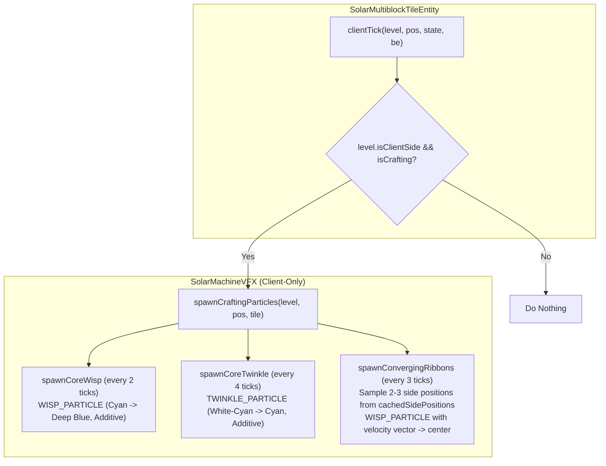

# Implementation Plan - Phase 6: Lodestone VFX & Visual Effects

Implement client-side visual effects using Lodestone particles for the Floating Multiblock Solar Machine during active crafting operations.

## Goal Description
Enhance the player experience by providing immersive, high-FPS visual feedback when the multiblock solar machine is actively processing recipes:
1. **Solar Core Wisps**: Glowing cyan-to-blue plasma wisps continuously orbiting and rising from the central controller core.
2. **Solar Flares / Twinkles**: Intermittent bright white-cyan sparkles in the machine's central field.
3. **Converging Energy Ribbons**: Throttled energy streams flowing inward from the 16 floating `SideStructureBlock` locations into the central controller core.
4. **Client-Tick Integration**: Hook `SolarMultiblockTileEntity.clientTick` so effects run entirely on the client side using synced `isCrafting` and `cachedSidePositions`, without any network packet spam or server performance impact.

> [!NOTE]
> The layered vanilla audio cues (`BEACON_ACTIVATE`, `CONDUIT_ACTIVATE`, `BEACON_AMBIENT`, `CRAFTER_CRAFT`, `VAULT_ACTIVATE`, `FIRE_EXTINGUISH`, and `CONDUIT_DEACTIVATE`) were already integrated into `SolarMultiblockTileEntity` during Phase 4 and are functioning as planned. Phase 6 focuses strictly on client particle visuals.

---

## User Review Required

> [!IMPORTANT]
> **Particle Density & Throttling**:
> To guarantee 60+ FPS even with multiple machines running concurrently, side-block particle emission is throttled: every 3 ticks, 2–3 random side blocks are chosen from the 16 formed positions to cast energy ribbons toward the center. This creates a lively, continuous flowing effect while capping active particles to ~25–35 per machine.

---

## Architecture & Visual Flow



---

## Proposed Changes

### Client VFX Component

#### [NEW] `src/main/kotlin/net/modelai/website/client/vfx/SolarMachineVFX.kt`
- Create client-only visual effect controller:
  - `spawnCraftingParticles(level: Level, pos: BlockPos, tile: SolarMultiblockTileEntity)`:
    - Checks `level.gameTime` for tick cadence.
    - Spawns core wisps every 2 ticks using `LodestoneParticleTypes.WISP_PARTICLE` with `LodestoneWorldParticleRenderType.ADDITIVE`, gentle upward float (`gravity = -0.01f`), and `#00F0FF` $\rightarrow$ `#0055FF` color transition.
    - Spawns core twinkles every 4 ticks using `LodestoneParticleTypes.TWINKLE_PARTICLE` with `#B4FFFF` $\rightarrow$ `#00F0FF` transition.
    - Spawns converging ribbons every 3 ticks by selecting 2–3 random positions from `tile.cachedSidePositions`, calculating velocity `(dx / 12, dy / 12, dz / 12)`, setting friction to `1.0f` (no drag), `gravity = 0f`, and `enableNoClip()`.

```kotlin
package net.modelai.website.client.vfx

import net.minecraft.core.BlockPos
import net.minecraft.world.level.Level
import net.minecraft.world.phys.Vec3
import net.modelai.website.block.entity.SolarMultiblockTileEntity
import team.lodestar.lodestone.registry.common.particle.LodestoneParticleTypes
import team.lodestar.lodestone.systems.particle.builder.WorldParticleBuilder
import team.lodestar.lodestone.systems.particle.data.GenericParticleData
import team.lodestar.lodestone.systems.particle.data.color.ColorParticleData
import team.lodestar.lodestone.systems.particle.render_types.LodestoneWorldParticleRenderType
import java.awt.Color

object SolarMachineVFX {

    private val CYAN_COLOR = Color(0, 240, 255)
    private val DEEP_BLUE_COLOR = Color(0, 85, 255)
    private val WHITE_CYAN_COLOR = Color(180, 255, 255)
    private val AZURE_COLOR = Color(30, 144, 255)

    fun spawnCraftingParticles(level: Level, pos: BlockPos, tile: SolarMultiblockTileEntity) {
        val gameTime = level.gameTime
        val center = Vec3.atCenterOf(pos)

        // 1. Core Plasma Wisps (every 2 ticks)
        if (gameTime % 2L == 0L) {
            spawnCoreWisp(level, center)
        }

        // 2. Core Sparkle / Twinkle (every 4 ticks)
        if (gameTime % 4L == 0L) {
            spawnCoreTwinkle(level, center)
        }

        // 3. Converging Energy Ribbons from Side Structure Blocks (every 3 ticks)
        if (gameTime % 3L == 0L) {
            spawnConvergingRibbons(level, center, tile.cachedSidePositions)
        }
    }

    private fun spawnCoreWisp(level: Level, center: Vec3) {
        WorldParticleBuilder.create(LodestoneParticleTypes.WISP_PARTICLE)
            .setScaleData(GenericParticleData.create(0.25f, 0.05f).build())
            .setTransparencyData(GenericParticleData.create(0.75f, 0.0f).build())
            .setColorData(ColorParticleData.create(CYAN_COLOR, DEEP_BLUE_COLOR).build())
            .setLifetime(20)
            .setGravity(-0.01f)
            .setRandomMotion(0.02, 0.03, 0.02)
            .setRenderType(LodestoneWorldParticleRenderType.ADDITIVE)
            .enableNoClip()
            .spawn(level, center.x, center.y + 0.1, center.z)
    }

    private fun spawnCoreTwinkle(level: Level, center: Vec3) {
        WorldParticleBuilder.create(LodestoneParticleTypes.TWINKLE_PARTICLE)
            .setScaleData(GenericParticleData.create(0.2f, 0.0f).build())
            .setTransparencyData(GenericParticleData.create(0.9f, 0.0f).build())
            .setColorData(ColorParticleData.create(WHITE_CYAN_COLOR, CYAN_COLOR).build())
            .setLifetime(10)
            .setRandomOffset(0.2, 0.2, 0.2)
            .setRenderType(LodestoneWorldParticleRenderType.ADDITIVE)
            .enableNoClip()
            .spawn(level, center.x, center.y + 0.15, center.z)
    }

    private fun spawnConvergingRibbons(level: Level, coreCenter: Vec3, sidePositions: List<BlockPos>) {
        if (sidePositions.isEmpty()) return

        val sampleCount = minOf(3, sidePositions.size)
        val sampled = sidePositions.shuffled().take(sampleCount)

        for (sidePos in sampled) {
            val start = Vec3.atCenterOf(sidePos)
            val dx = coreCenter.x - start.x
            val dy = (coreCenter.y + 0.1) - start.y
            val dz = coreCenter.z - start.z
            val dist = kotlin.math.sqrt(dx * dx + dy * dy + dz * dz)
            if (dist < 0.1) continue

            val travelTicks = 12
            val vx = dx / travelTicks
            val vy = dy / travelTicks
            val vz = dz / travelTicks

            WorldParticleBuilder.create(LodestoneParticleTypes.WISP_PARTICLE)
                .setScaleData(GenericParticleData.create(0.18f, 0.04f).build())
                .setTransparencyData(GenericParticleData.create(0.85f, 0.1f).build())
                .setColorData(ColorParticleData.create(WHITE_CYAN_COLOR, AZURE_COLOR).build())
                .setLifetime(travelTicks)
                .setMotion(vx, vy, vz)
                .setFriction(1.0f)
                .setGravity(0f)
                .setRenderType(LodestoneWorldParticleRenderType.ADDITIVE)
                .enableNoClip()
                .spawn(level, start.x, start.y, start.z)
        }
    }
}
```

---

### Machine Tile Entity Hook

#### [MODIFY] `src/main/kotlin/net/modelai/website/block/entity/SolarMultiblockTileEntity.kt`
- Add import for `net.modelai.website.client.vfx.SolarMachineVFX`.
- Override `clientTick(level: Level, pos: BlockPos, state: BlockState, blockEntity: SolarMultiblockTileEntity)`:
```kotlin
    override fun clientTick(
        level: Level,
        pos: BlockPos,
        state: BlockState,
        blockEntity: SolarMultiblockTileEntity
    ) {
        super.clientTick(level, pos, state, blockEntity)
        if (level.isClientSide && isCrafting) {
            SolarMachineVFX.spawnCraftingParticles(level, pos, this)
        }
    }
```

---

## Verification Plan

### Automated Verification
1. **Kotlin Compilation**:
   ```powershell
   $env:JAVA_HOME = 'C:/Program Files/Eclipse Adoptium/jdk-21.0.12.8-hotspot'
   .\gradlew.bat compileKotlin
   ```
2. **Full Project Build**:
   ```powershell
   $env:JAVA_HOME = 'C:/Program Files/Eclipse Adoptium/jdk-21.0.12.8-hotspot'
   .\gradlew.bat build -x test
   ```

### Manual In-World Verification
1. Launch client:
   ```powershell
   .\gradlew.bat runClient
   ```
2. Build the $5 \times 5 \times 5$ multiblock structure (16 `SideStructureBlock`s + 1 `SolarMultiblockMachineBlock` at center).
3. Insert ingredients (e.g. Diamond + Channel Apple + 1,000 mB Water) and supply FE under direct sunlight.
4. Verify:
   - Floating cyan/blue plasma wisps continuously hover around the controller block.
   - Sparkling twinkles burst in the machine's core.
   - Energy ribbons stream inwards from the side blocks into the core.
   - Particles disappear immediately when daylight is obstructed or crafting halts.
