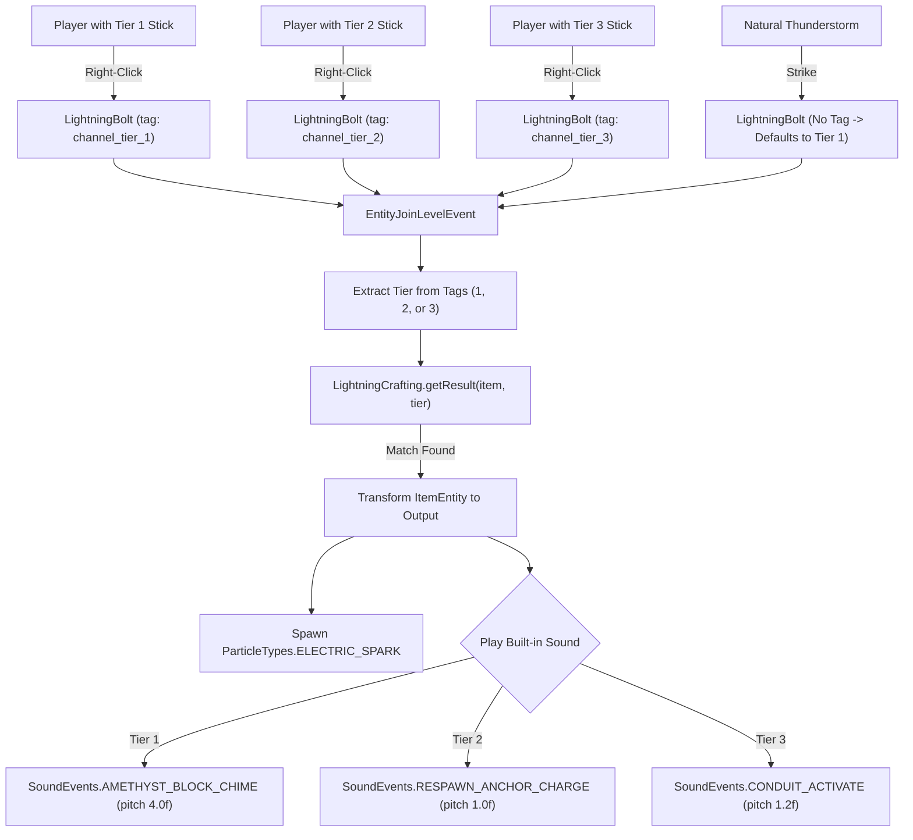

# Implementation Plan: Tiered Lightning Crafting System (Tier 1, Tier 2, Tier 3)

## 📌 Goal Description
Expand the current in-world lightning crafting system into a **3-Tiered Crafting System**.
Players will have access to 3 Channel Sticks:
1. **Tier 1 Channel Stick** (`channel_stick`): Crafts Tier 1 recipes. Also triggered by naturally occurring lightning strikes. Built-in sound: `SoundEvents.AMETHYST_BLOCK_CHIME`.
2. **Tier 2 Channel Stick** (`channel_stick_tier_2`): Crafts Tier 2 recipes. Built-in sound: `SoundEvents.RESPAWN_ANCHOR_CHARGE`.
3. **Tier 3 Channel Stick** (`channel_stick_tier_3`): Crafts Tier 3 recipes. Built-in sound: `SoundEvents.CONDUIT_ACTIVATE`.

Crafting behavior is **Strict / Exclusive**: Each stick tier ONLY crafts recipes registered to its exact tier.

---

## 🏗️ Architecture & Mechanism



---

## 🛠️ Step-by-Step Code Changes

### Step 1: Update Recipe Storage in [`LightningCrafting.kt`](file:///A:/IDE/Intellija/not-enough-channels-1.21.1/src/main/kotlin/net/modelai/website/crafting/LightningCrafting.kt)
Update `LightningCrafting` to store recipes with a `tier: Int` (1, 2, or 3) and check recipes strictly by tier:

```kotlin
package net.modelai.website.crafting

import net.minecraft.world.item.Item
import java.util.function.Supplier

object LightningCrafting {

    data class Recipe(
        val tier: Int,
        val input: Supplier<out Item>,
        val output: Supplier<out Item>
    )

    private val RECIPES = mutableListOf<Recipe>()

    /**
     * Register a recipe for a specific tier (1, 2, or 3).
     */
    fun register(tier: Int, input: Supplier<out Item>, output: Supplier<out Item>) {
        RECIPES.add(Recipe(tier, input, output))
    }

    /**
     * Backwards-compatible overload defaulting to Tier 1.
     */
    fun register(input: Supplier<out Item>, output: Supplier<out Item>) {
        register(1, input, output)
    }

    /**
     * Finds the output item strictly matching the input item and tier.
     */
    fun getResult(input: Item, tier: Int): Item? {
        return RECIPES.firstOrNull { it.tier == tier && it.input.get() == input }?.output?.get()
    }

    /**
     * Checks if the item has any recipe across all tiers (used to cancel natural damage).
     */
    fun hasRecipe(input: Item): Boolean {
        return RECIPES.any { it.input.get() == input }
    }
}
```

---

### Step 2: Update [`LightningCraftingHandler.kt`](file:///A:/IDE/Intellija/not-enough-channels-1.21.1/src/main/kotlin/net/modelai/website/crafting/LightningCraftingHandler.kt)
Detect the tier from the lightning bolt's vanilla tags and trigger the corresponding tier sound:

```kotlin
package net.modelai.website.crafting

import net.minecraft.core.particles.ParticleTypes
import net.minecraft.server.level.ServerLevel
import net.minecraft.sounds.SoundEvents
import net.minecraft.sounds.SoundSource
import net.minecraft.world.entity.LightningBolt
import net.minecraft.world.entity.item.ItemEntity
import net.minecraft.world.item.ItemStack
import net.minecraft.world.phys.AABB
import net.neoforged.bus.api.SubscribeEvent
import net.neoforged.neoforge.event.entity.EntityJoinLevelEvent
import net.neoforged.neoforge.event.entity.EntityStruckByLightningEvent

object LightningCraftingHandler {

    @SubscribeEvent
    fun onEntityJoinLevel(event: EntityJoinLevelEvent) {
        val level = event.level as? ServerLevel ?: return
        val lightning = event.entity as? LightningBolt ?: return

        // Determine tier from tags (defaults to Tier 1 for natural lightning strikes)
        val tier = when {
            lightning.tags.contains("channel_tier_3") -> 3
            lightning.tags.contains("channel_tier_2") -> 2
            else -> 1
        }

        // 3-block horizontal and vertical radius around strike (6x6x6 cube)
        val area = AABB.ofSize(lightning.position(), 6.0, 6.0, 6.0)
        val items = level.getEntitiesOfClass(ItemEntity::class.java, area)

        for (itemEntity in items) {
            val currentStack = itemEntity.item
            val resultItem = LightningCrafting.getResult(currentStack.item, tier) ?: continue

            // Transform item in-place preserving stack count
            itemEntity.item = ItemStack(resultItem, currentStack.count)

            // Visual particle sparks
            level.sendParticles(
                ParticleTypes.ELECTRIC_SPARK,
                itemEntity.x, itemEntity.y + 0.2, itemEntity.z,
                50, 0.75, 0.75, 0.75, 0.3
            )

            // Distinct Minecraft built-in sound per tier
            val (sound, pitch) = when (tier) {
                2 -> SoundEvents.RESPAWN_ANCHOR_CHARGE to 1.0f
                3 -> SoundEvents.CONDUIT_ACTIVATE to 1.2f
                else -> SoundEvents.AMETHYST_BLOCK_CHIME to 4.0f
            }

            level.playSound(
                null,
                itemEntity.blockPosition(),
                sound,
                SoundSource.BLOCKS,
                50f,
                pitch
            )
        }
    }

    @SubscribeEvent
    fun onEntityStruckByLightning(event: EntityStruckByLightningEvent) {
        val itemEntity = event.entity as? ItemEntity ?: return
        if (LightningCrafting.hasRecipe(itemEntity.item.item)) {
            event.isCanceled = true // Prevent burning/destruction from natural lightning
        }
    }
}
```

---

### Step 3: Update [`ChannelStickItem.kt`](file:///A:/IDE/Intellija/not-enough-channels-1.21.1/src/main/kotlin/net/modelai/website/item/custom/ChannelStickItem.kt)
Support `tier: Int` in constructor, tag the spawned `LightningBolt`, and display tooltip in-game:

```kotlin
package net.modelai.website.item.custom

import net.minecraft.ChatFormatting
import net.minecraft.network.chat.Component
import net.minecraft.server.level.ServerPlayer
import net.minecraft.world.InteractionHand
import net.minecraft.world.InteractionResult
import net.minecraft.world.InteractionResultHolder
import net.minecraft.world.entity.EntityType
import net.minecraft.world.entity.player.Player
import net.minecraft.world.item.Item
import net.minecraft.world.item.ItemStack
import net.minecraft.world.item.TooltipFlag
import net.minecraft.world.item.context.UseOnContext
import net.minecraft.world.level.Level
import net.minecraft.world.phys.AABB
import net.minecraft.world.phys.HitResult
import net.minecraft.world.phys.Vec3

class ChannelStickItem(
    val tier: Int = 1,
    properties: Properties
) : Item(properties) {

    override fun use(level: Level, player: Player, usedHand: InteractionHand): InteractionResultHolder<ItemStack> {
        val itemStack = player.getItemInHand(usedHand)

        if (!level.isClientSide) {
            val hitResult = player.pick(12.0, 1.0f, false)
            if (hitResult.type == HitResult.Type.BLOCK) {
                spawnLightning(level, hitResult.location, player)
                player.cooldowns.addCooldown(this, 10)
                return InteractionResultHolder.sidedSuccess(itemStack, false)
            }
        }

        return InteractionResultHolder.sidedSuccess(itemStack, level.isClientSide)
    }

    override fun useOn(context: UseOnContext): InteractionResult {
        val level = context.level
        val player = context.player

        if (!level.isClientSide) {
            val strikePos = Vec3.atBottomCenterOf(context.clickedPos.above())
            spawnLightning(level, strikePos, player)
            player?.cooldowns?.addCooldown(this, 10)
        }

        return InteractionResult.sidedSuccess(level.isClientSide)
    }

    private fun spawnLightning(level: Level, pos: Vec3, player: Player?) {
        val lightning = EntityType.LIGHTNING_BOLT.create(level) ?: return
        lightning.moveTo(pos)
        lightning.setVisualOnly(true)
        // Tag the bolt with the stick's tier
        lightning.addTag("channel_tier_$tier")
        level.addFreshEntity(lightning)

        if (player is ServerPlayer) {
            lightning.cause = player
        }

        val area = AABB.ofSize(pos, 5.0, 5.0, 5.0)
        val targets = level.getEntitiesOfClass(net.minecraft.world.entity.LivingEntity::class.java, area) { it != player }
        for (target in targets) {
            target.hurt(level.damageSources().lightningBolt(), 5.0f)
        }
    }

    override fun appendHoverText(
        stack: ItemStack,
        context: TooltipContext,
        tooltipComponents: MutableList<Component>,
        tooltipFlag: TooltipFlag
    ) {
        val (text, color) = when (tier) {
            2 -> "Tier II" to ChatFormatting.GOLD
            3 -> "Tier III" to ChatFormatting.LIGHT_PURPLE
            else -> "Tier I" to ChatFormatting.AQUA
        }
        tooltipComponents.add(Component.literal(text).withStyle(color))
        super.appendHoverText(stack, context, tooltipComponents, tooltipFlag)
    }
}
```

---

### Step 4: Register Tier 2 and Tier 3 in [`ModItems.kt`](file:///A:/IDE/Intellija/not-enough-channels-1.21.1/src/main/kotlin/net/modelai/website/item/ModItems.kt)

```kotlin
    val CHANNEL_STICK: DeferredItem<ChannelStickItem> =
        ITEMS.register("channel_stick", Supplier { ChannelStickItem(1, Item.Properties().stacksTo(1)) })

    val CHANNEL_STICK_TIER_2: DeferredItem<ChannelStickItem> =
        ITEMS.register("channel_stick_tier_2", Supplier { ChannelStickItem(2, Item.Properties().stacksTo(1)) })

    val CHANNEL_STICK_TIER_3: DeferredItem<ChannelStickItem> =
        ITEMS.register("channel_stick_tier_3", Supplier { ChannelStickItem(3, Item.Properties().stacksTo(1)) })
```

---

### Step 5: Add to Creative Tab in [`ModCreativeTabs.kt`](file:///A:/IDE/Intellija/not-enough-channels-1.21.1/src/main/kotlin/net/modelai/website/tab/ModCreativeTabs.kt)

```kotlin
    displayItems { _, output ->
        output.accept(ModItems.CHANNEL_SNOWBALL.get())
        output.accept(ModItems.CHANNEL_ROCK.get())
        output.accept(ModItems.CHANNEL_STICK.get())
        output.accept(ModItems.CHANNEL_STICK_TIER_2.get())
        output.accept(ModItems.CHANNEL_STICK_TIER_3.get())
        output.accept(ModItems.CHANNEL_APPLE.get())
    }
```

---

### Step 6: Create Item Models
Create:
- `src/main/resources/assets/notenoughchannels/models/item/channel_stick_tier_2.json`:
  ```json
  {
    "parent": "minecraft:item/stick"
  }
  ```
- `src/main/resources/assets/notenoughchannels/models/item/channel_stick_tier_3.json`:
  ```json
  {
    "parent": "minecraft:item/stick"
  }
  ```

---

### Step 7: Update [`en_us.json`](file:///A:/IDE/Intellija/not-enough-channels-1.21.1/src/main/resources/assets/notenoughchannels/lang/en_us.json)
```json
  "item.notenoughchannels.channel_stick": "Channel Stick (Tier 1)",
  "item.notenoughchannels.channel_stick_tier_2": "Channel Stick (Tier 2)",
  "item.notenoughchannels.channel_stick_tier_3": "Channel Stick (Tier 3)",
```

---

### Step 8: Register Recipes in [`NotEnoughChannels.kt`](file:///A:/IDE/Intellija/not-enough-channels-1.21.1/src/main/kotlin/net/modelai/website/NotEnoughChannels.kt)
Register recipes with their specific tiers:
```kotlin
// Tier 1 Recipes
LightningCrafting.register(1, ModItems.CHANNEL_SNOWBALL, ModItems.CHANNEL_ROCK)
LightningCrafting.register(1, Supplier { Items.APPLE }, ModItems.CHANNEL_APPLE)

// Example Tier 2 / Tier 3 recipes can be added here whenever needed:
// LightningCrafting.register(2, Supplier { Items.GOLD_INGOT }, Supplier { Items.DIAMOND })
// LightningCrafting.register(3, Supplier { Items.NETHER_STAR }, ...)
```

---

## 🧪 Verification Plan

### 1. Automated Build Check
```powershell
.\gradlew.bat compileKotlin
```
Verifies clean compilation with Java 21 and Kotlin 2.4.0.

### 2. In-Game Testing
1. Run `./gradlew.bat runClient`.
2. Grab Tier 1, Tier 2, and Tier 3 sticks from the Creative Tab.
3. Drop an `Apple` and strike with `Channel Stick (Tier 1)` -> crafts `Channel Apple` and plays `Amethyst Chime`.
4. Drop an `Apple` and strike with `Channel Stick (Tier 2)` -> does NOT craft (strict tier separation confirmed).
5. Add/test a Tier 2 recipe and strike with Tier 2 stick -> crafts and plays `Respawn Anchor Charge`.
6. Add/test a Tier 3 recipe and strike with Tier 3 stick -> crafts and plays `Conduit Activate`.
